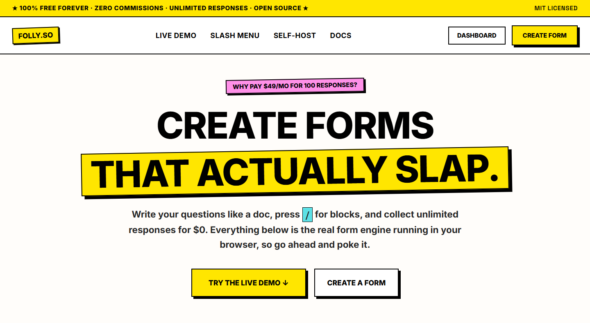
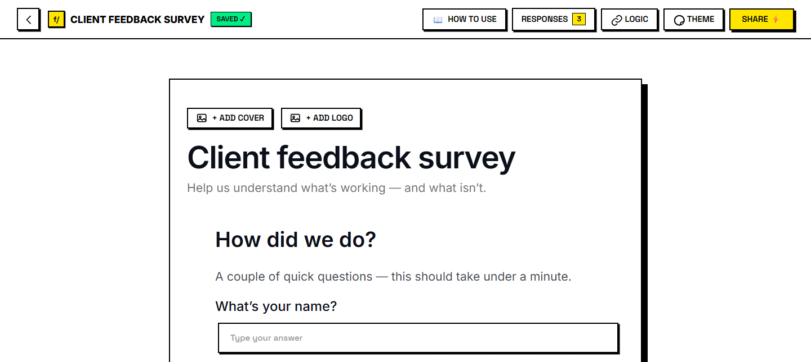
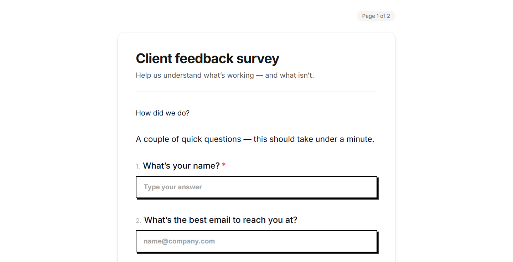

# Folly.so

A fast, neo-brutalist, self-hostable form builder. Type your questions like you would in a document, hit `/` to insert blocks, and collect unlimited responses.



## Features

- **Document-style editor** — write forms like a Notion doc, with `/` slash commands and drag to reorder
- **Rich block library** — inputs, choices, ratings, NPS, matrix, ranking, embeds
- **Conditional logic** — show/hide questions, branch across pages, pipe answers with `@mention`
- **Scoring, custom CSS, password protection, response limits, scheduling**
- **Responses dashboard** with CSV export
- **Self-hostable** — one container plus PostgreSQL

Full list in [docs/features.md](docs/features.md).

## Screenshots

| Editor | Live form |
| :---: | :---: |
|  |  |

## Quick Start

```bash
git clone https://github.com/dionjoshualobo/folly.so.git
cd folly.so
docker compose up --build
```

Open **http://localhost:3001**. Demo forms and sample responses are seeded on first launch.

## Documentation

- [Features](docs/features.md) — every block type and form control
- [Self-hosting](docs/self-hosting.md) — configuration and production build
- [Development](docs/development.md) — local setup and tech stack
- [MCP server](mcp/README.md) — let AI agents create and manage forms

## License

MIT
